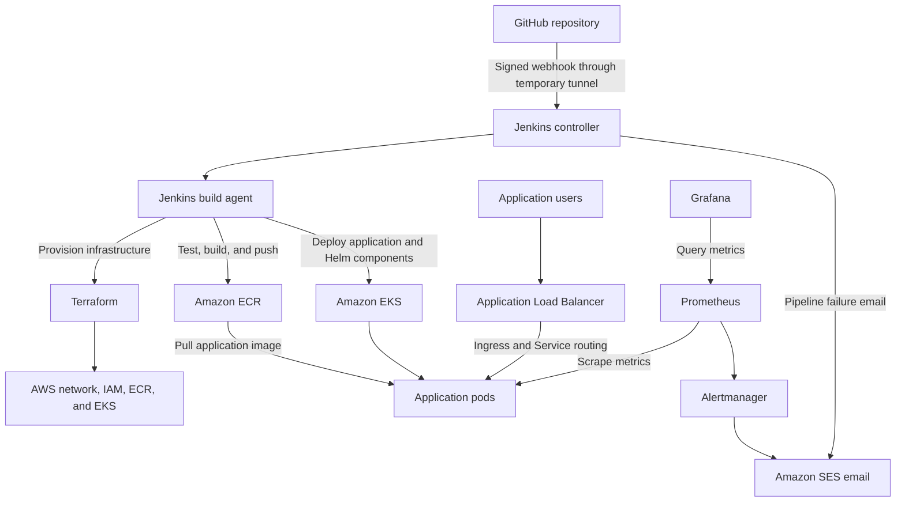

# DevOps Web Application Platform

An end-to-end DevOps capstone demonstrating automated infrastructure provisioning, configuration management, application delivery, and monitoring on AWS.

Built as part of the Hero Vired DevOps Capstone.

## Implementation Status

Implemented and verified locally:

- Flask application with version and hostname information.
- Liveness and readiness endpoints.
- Prometheus metrics with HTTP request tracking.
- Six automated application tests.
- Docker image running Gunicorn as a non-root user.
- Docker Compose setup with an application health check.

Implemented and verified in AWS:

- S3 Terraform state bucket with versioning, encryption, public access blocking, and state locking.
- Jenkins controller and build agent provisioned on EC2 using Terraform.
- Jenkins and agent configuration managed with Ansible.
- Build agent verified with Docker, AWS CLI, Terraform, kubectl, Helm, and Ansible.
- Jenkins agent uses an EC2 IAM role for AWS authentication.

- Amazon ECR stores application images tagged with the Git commit and Jenkins build number.
- Amazon EKS runs application replicas across two Availability Zones.
- Jenkins tests, builds, pushes, deploys, and verifies the application version.
- Signed GitHub webhooks automatically trigger the application pipeline.
- AWS Load Balancer Controller provides application access through an Application Load Balancer.
- Kubernetes health checks and CPU-based autoscaling are configured.
- Autoscaling from two to four replicas and back to two was verified.
- Prometheus collects application and infrastructure metrics.
- Grafana displays cluster and application dashboards.
- Jenkins automates monitoring and load balancer controller installation with Helm.
- Amazon SES delivers Jenkins failure notifications and Alertmanager firing and recovery emails.
- Pod replacement and deployment rollback were tested.

This is a learning environment. Application access currently uses HTTP, monitoring storage is ephemeral, and the webhook demonstration requires a running local forwarder, SSH tunnel, and temporary Cloudflare tunnel.

AWS resources incur charges while provisioned. Stopping Jenkins instances or scaling workers to zero does not remove all costs; EKS, NAT Gateway, load balancer, and storage resources can continue to incur charges.

## Architecture



Terraform provisions infrastructure, Ansible configures the Jenkins servers, and Jenkins runs application and Helm deployment pipelines. Application replicas run on EKS worker nodes in private subnets across two Availability Zones.

## Run Locally with Docker

Prerequisites: Docker Engine and Docker Compose.

From the repository root:

```bash
docker compose up -d --build --wait
```

Open http://localhost:8000.

Check container health:

```bash
docker compose ps
```

Stop and remove the local containers:

```bash
docker compose down
```

## Run Automated Tests

Prerequisite: Python 3.12.

From the repository root:

```bash
python3 -m venv .venv
source .venv/bin/activate
python -m pip install -r requirements-dev.txt
python -m pytest -q
```

## Application Endpoints

| Endpoint | Purpose |
|---|---|
| `/` | Application introduction, version, and hostname |
| `/api/info` | Application version and hostname |
| `/health/live` | Process liveness |
| `/health/ready` | Readiness to accept traffic |
| `/metrics` | Prometheus application and process metrics |

## Repository Layout

| Path | Purpose |
|---|---|
| `app/` | Application code and runtime dependencies |
| `tests/` | Automated application tests |
| `infrastructure/bootstrap/` | Terraform state storage setup |
| `infrastructure/management/` | Jenkins EC2 infrastructure and agent IAM permissions |
| `infrastructure/platform/` | Application network, ECR, EKS, and controller IAM configuration |
| `ansible/` | Jenkins controller and build agent configuration |
| `jenkins/` | Infrastructure, application, monitoring, and platform pipelines |
| `kubernetes/` | Application Deployment, Service, autoscaling, and Ingress |
| `monitoring/` | Monitoring Helm values, application dashboard, scrape configuration, and alerts |
| `platform/` | AWS Load Balancer Controller Helm values |
| `scripts/` | Inventory generation and local webhook forwarding utilities |
| `docs/screenshots/` | Project evidence |
| `docs/runbooks/` | Operational documentation |
| `Dockerfile` | Non-root application image |
| `docker-compose.yml` | Local container configuration |
| `requirements-dev.txt` | Development and test dependencies |

## Local Configuration

Docker Compose defaults `APP_VERSION` to `compose-local`.

To override it:

```bash
APP_VERSION=my-local-version docker compose up -d --wait
```

The application is published on the computer's loopback address only.

## Operational Documentation

- [Jenkins pipelines](docs/runbooks/pipelines.md)
- [Troubleshooting](docs/runbooks/troubleshooting.md)
- [Validation results and limitations](docs/runbooks/validation.md)
- [Cost management](docs/runbooks/cost-management.md)
- [Project screenshots](docs/screenshots/)

## Credentials and Configuration

Do not commit credentials, private keys, environment files, Terraform state, or saved Terraform plans.
